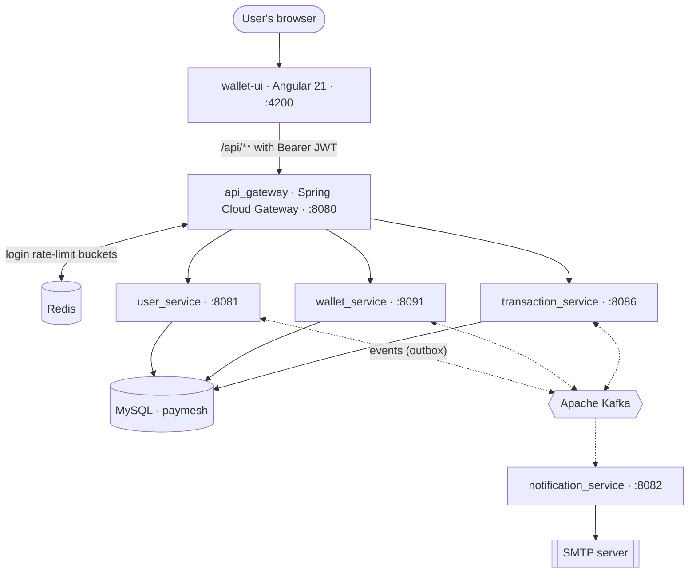
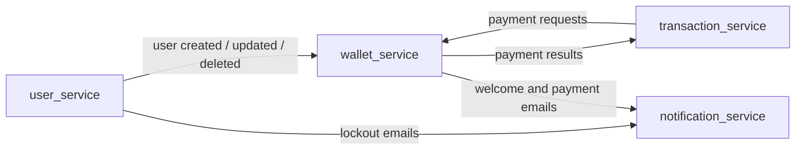
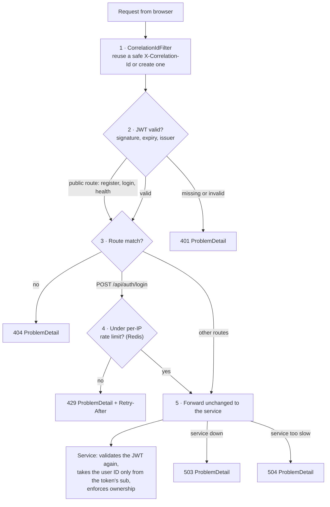
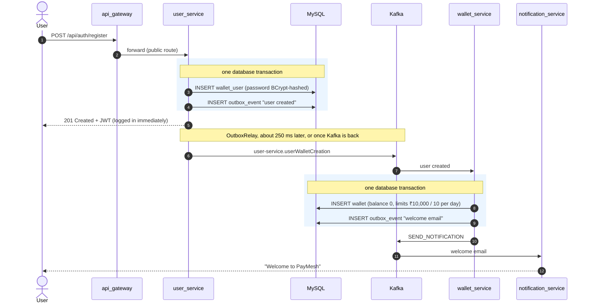
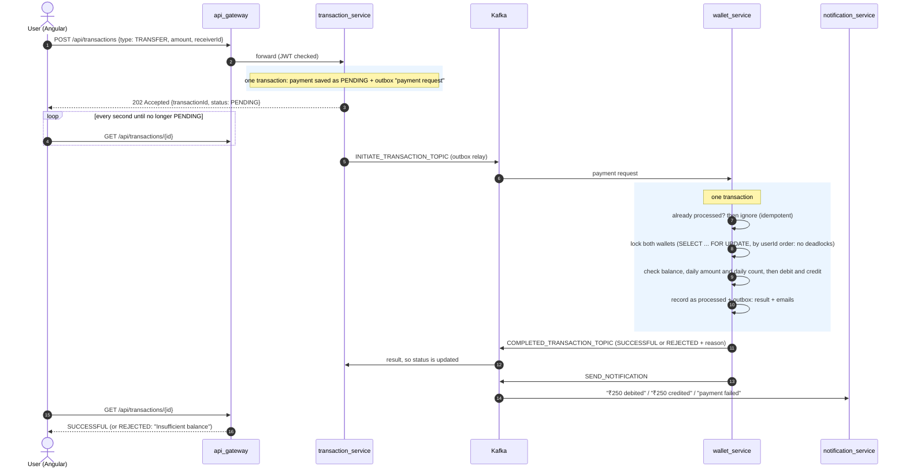
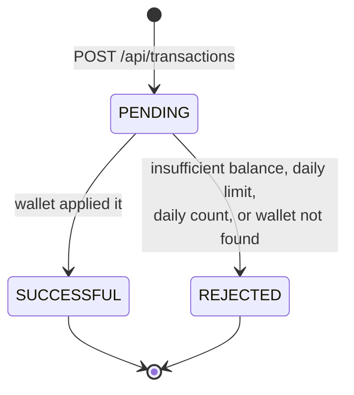
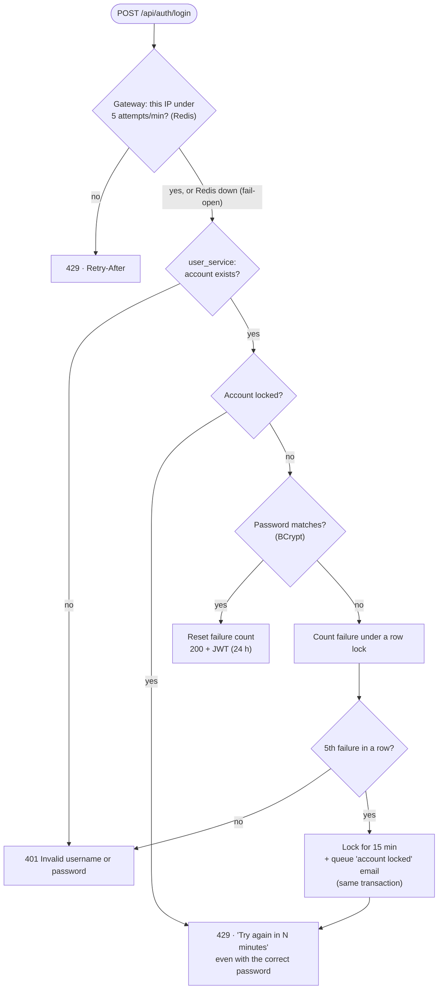
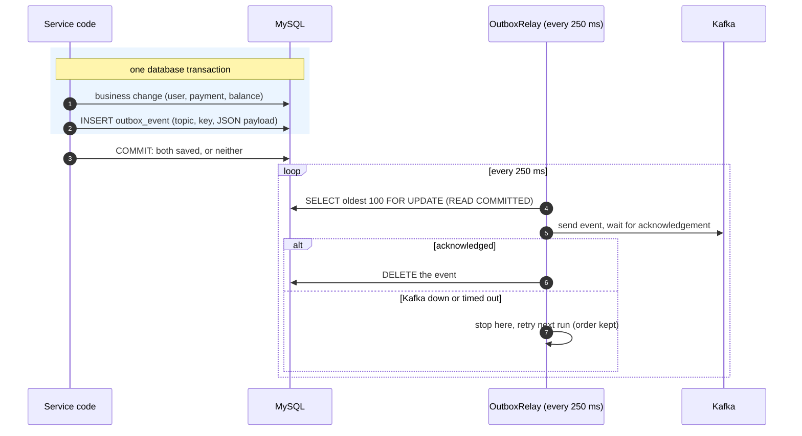
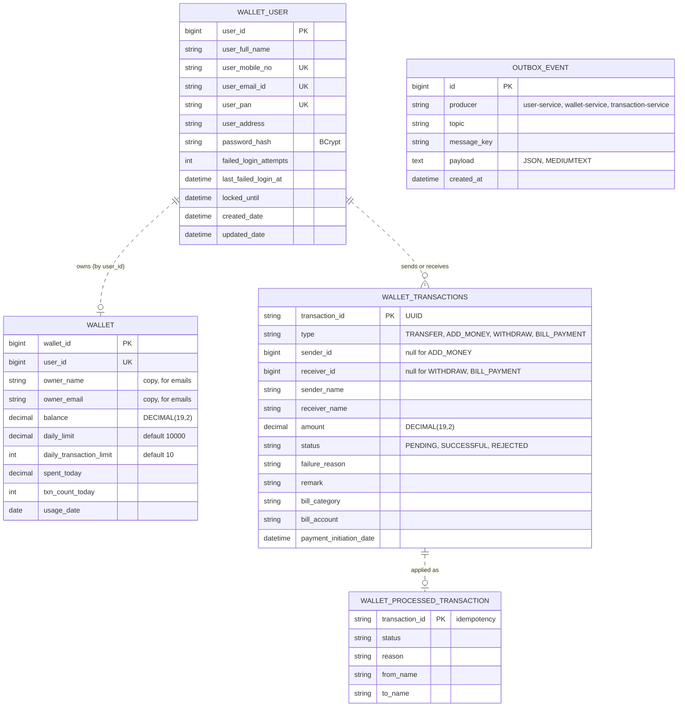
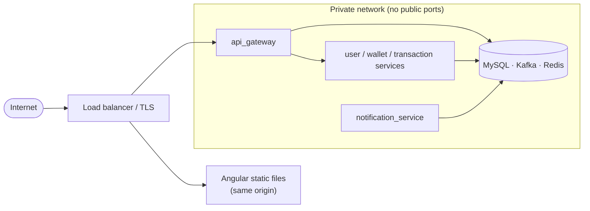

# PayMesh: Event-Driven Digital Wallet Platform

[](https://github.com/adityachauhan564/PayMesh/actions/workflows/ci.yml)

A secure, event-driven digital wallet built as **Spring Boot 4 microservices** on **Java 21**: centralized API routing through **Spring Cloud Gateway**, **JWT** authentication with **Spring Security**, asynchronous **Apache Kafka** messaging for transaction processing and notifications, **MySQL** storage, and an **Angular** web app.

Users can register, add money, send money to other users by mobile number, pay bills and recharges, withdraw to a bank, set daily limits, and see their full history, with an email for every money movement.


---

## Contents

1. [Features](#features)
2. [Architecture at a glance](#architecture-at-a-glance)
3. [Services](#services)
4. [How a request travels](#how-a-request-travels)
5. [Core flows](#core-flows): registration, payments, login
6. [Reliability: the transactional outbox](#reliability-the-transactional-outbox)
7. [Data model](#data-model)
8. [Kafka event catalogue](#kafka-event-catalogue)
9. [Security model](#security-model)
10. [API reference](#api-reference)
11. [Getting started](#getting-started)
12. [Configuration](#configuration)
13. [Testing](#testing)
14. [Project structure](#project-structure)
15. [Design decisions](#design-decisions)
16. [Known limitations and roadmap](#known-limitations-and-roadmap)
17. [Troubleshooting](#troubleshooting)

---

## Features

| | Feature | Details |
|---|---|---|
| 👤 | **Accounts** | Register with mobile, email and password (BCrypt); log in with mobile **or** email; view, edit and delete profile |
| 💰 | **Wallet** | Created automatically on sign-up; balance; daily spend limit (default ₹10,000) and daily payment count (default 10), both user-configurable |
| ➕ | **Add money** | Top up the wallet (bank side simulated) |
| ↗️ | **Send money** | Find the receiver by mobile number, confirm their name, pay |
| ⚡ | **Recharge and bills** | Mobile, DTH, electricity, water, gas, broadband |
| ⬇️ | **Withdraw** | Move money back to the bank (simulated) |
| 📜 | **History** | Paginated, with full details per transaction |
| ✉️ | **Email notifications** | Welcome, every debit and credit, failed payments, account locked |
| 🛡️ | **Security** | JWT auth at gateway **and** service, per-IP login rate limit, per-account lockout, ownership checks everywhere |
| 🔁 | **Reliability** | No event is ever lost: works through Kafka outages and catches up automatically |

---

## Architecture at a glance



Solid arrows are synchronous HTTP or database calls; dotted arrows are asynchronous Kafka events. Which events flow
where (every arrow is a Kafka topic, published through the [outbox](#reliability-the-transactional-outbox)):



**The big ideas**

- **One public door.** The browser only ever talks to the gateway. It routes requests, checks the JWT, rate-limits logins, adds a correlation ID and returns errors in one consistent format.
- **Services own their data and talk through events.** No service calls another over HTTP. A payment is a *saga*: `transaction_service` records the request, `wallet_service` moves the money atomically, and the result flows back as an event.
- **The wallet is the source of truth for money.** Every balance change happens in one database transaction, with row locks, balance and daily-limit checks, and duplicate protection.
- **Nothing is lost.** Events are written to a database *outbox* together with the data they describe, then relayed to Kafka. Kafka can be down and the system still accepts requests and catches up afterwards.

---

## Services

| Module | Port | Responsibility | Owns (tables) | Publishes | Consumes |
|---|---|---|---|---|---|
| **`api_gateway`** | 8080 | Single entry point: routing, JWT validation, login rate limiting, correlation IDs, uniform errors | (uses Redis) | n/a | n/a |
| **`user_service`** | 8081 | Register and login (issues JWT), profile CRUD, receiver lookup, account lockout | `wallet_user` | user created / updated / deleted, lockout email | n/a |
| **`wallet_service`** | 8091 | Wallets, balances, daily limits; **applies every payment atomically** | `wallet`, `wallet_processed_transaction` | payment result, welcome and payment emails | user events, payment requests |
| **`transaction_service`** | 8086 | Create payments, history, details; tracks status | `wallet_transactions` | payment request | payment result |
| **`notification_service`** | 8082 | Sends emails (logs them if SMTP isn't configured) | none | n/a | emails |
| **`paymesh-common`** | n/a | Shared code: event DTOs, topics, JWT validation, error handling, log correlation, **transactional outbox**, Kafka defaults | `outbox_event` (each service's own rows) | n/a | n/a |
| **`wallet-ui`** | 4200 | Angular app: login and register, dashboard, pay, history, profile | n/a | n/a | n/a |

All services share **one MySQL database** for simplicity, but each touches only its own tables and none uses another's, so they can be split into separate databases without code changes.

---

## How a request travels

Every API call passes through the same gateway pipeline before it reaches a service, and the service checks the token again.



Every response, including errors, carries `X-Correlation-Id`, and every service log line shows it (`INFO [e2e-trace-001] ...`), so one request can be followed through all logs.

---

## Core flows

### 1. Registration: account first, wallet follows



Until the wallet exists, `GET /api/wallets/me` answers *"Wallet not found yet, it is being created"*. The dashboard waits and retries.

### 2. Payments: a saga with the wallet as the source of truth

All four payment types use the same flow. Only which wallet is debited and which is credited changes:

| Type | Debits | Credits | Example |
|---|---|---|---|
| `TRANSFER` | sender | receiver | Pay a friend |
| `ADD_MONEY` | n/a (bank) | you | Top up |
| `WITHDRAW` | you | n/a (bank) | Cash out |
| `BILL_PAYMENT` | you | n/a (biller) | Mobile recharge, electricity, … |



**Payment status lifecycle**



Why the money stays correct:

- **No double spending.** Balance is checked and changed under a row lock, in the same transaction. In a test, 8 parallel ₹300 sends from a ₹1,200.50 balance gave exactly 4 successes and left ₹0.50.
- **No double applying.** Each `transactionId` is recorded in `wallet_processed_transaction` in the same transaction, so a redelivered message is ignored.
- **No lost payments.** The request and the result both go through the outbox.
- **Exact amounts.** Money is `BigDecimal` / `DECIMAL(19,2)` end to end.

### 3. Login: two independent brute-force defences



| Defence | Where | Stops | Default |
|---|---|---|---|
| **Per-IP rate limit** | gateway + Redis | one machine hammering many accounts | 5 attempts, then 1 every 12 s |
| **Per-account lockout** | user_service + MySQL | many machines hammering one account | 5 wrong passwords, then 15 min lock |

---

## Reliability: the transactional outbox

Writing to the database and then publishing to Kafka are **two separate systems**. If the process crashes between them, or Kafka is down, an event is lost: a user with no wallet, or a payment stuck at PENDING forever. The outbox makes the event part of the database transaction.



| Situation | What happens |
|---|---|
| Kafka is down | Requests still succeed **instantly**; events wait in `outbox_event`; the relay retries; everything completes once Kafka is back (verified live) |
| Service crashes after commit | Events are already in the table; the relay sends them after restart |
| Crash after Kafka ack, before delete | The event is sent **again**: delivery is *at-least-once*, so consumers are idempotent (below) |
| Two instances of one service | Rows are locked while being sent: no concurrent double publishing, order kept |
| Kafka slow to respond | Writers are **not** blocked: the relay reads at `READ COMMITTED`, so MySQL takes no gap locks |

**Every consumer tolerates duplicates:**

| Consumer | Why a duplicate is harmless |
|---|---|
| Create wallet | Skips if the wallet already exists (no second welcome email) |
| Update or delete wallet owner | Setting the same values again changes nothing |
| Apply payment | `wallet_processed_transaction` records each `transactionId` |
| Update payment status | Setting the same status again changes nothing |
| Send email | **May send twice** in the rare crash case above |

`Outbox.publish(...)` runs only inside an existing transaction (`Propagation.MANDATORY`). Calling it anywhere else is a programming error and fails immediately.

---

## Data model

The services share one database but **no foreign keys cross service boundaries**. The dotted lines are logical references by ID.



Tables are created and updated by Hibernate (`ddl-auto=update`), and the database itself is created on first start (`createDatabaseIfNotExist=true`).

---

## Kafka event catalogue

| Topic | Producer | Consumer(s) | Key | Payload |
|---|---|---|---|---|
| `user-service.userWalletCreation` | user_service | wallet_service | userId | `{userId, userName, userEmailId}` |
| `user-service.userUpdation` | user_service | wallet_service | userId | `{userId, userName, userEmailId}` |
| `user-service.userDeletion` | user_service | wallet_service | userId | `userId` (deletes the wallet only if its balance is 0) |
| `INITIATE_TRANSACTION_TOPIC` | transaction_service | wallet_service | transactionId | `{transactionId, fromUserId, toUserId, amount}` |
| `COMPLETED_TRANSACTION_TOPIC` | wallet_service | transaction_service | transactionId | `{transactionId, paymentStatus, reason, fromName, toName}` |
| `SEND_NOTIFICATION` | user_service, wallet_service | notification_service | recipient email | `{receiverMailId, subject, message}` |

Keys keep ordering per user and per transaction. Payload classes live in `paymesh-common/.../dto`.

---

## Security model

**Two layers, no shortcuts.** The gateway rejects bad tokens early. Each service validates the **same token again** and takes the user's identity only from its `sub` claim, never from a request field. A `senderId` or `userId` sent in a request body is ignored. The gateway adds no identity headers, and no service trusts any.

| Area | Implementation |
|---|---|
| **Tokens** | HS256 JWT issued by user_service: `sub` = userId, `name`, `iss` = `paymesh`, 24 h expiry. Signature, expiry and issuer are checked by the gateway and every service. |
| **Secrets** | `JWT_SECRET` must be set (≥ 32 bytes, same everywhere). **Services refuse to start without it**; a development value exists only in the `local` profile. No credentials are in code. |
| **Public endpoints** | Only `POST /api/auth/register`, `POST /api/auth/login` and `GET /actuator/health` (status only). Everything else needs a token; unknown paths are denied. |
| **Ownership** | Each user sees and changes only their own profile, wallet and transactions; other people's transactions return **404**. |
| **Brute force** | Per-IP rate limit at the gateway (Redis) and per-account lockout in user_service ([details](#3-login-two-independent-brute-force-defences)) |
| **Passwords** | BCrypt; never logged or returned |
| **Errors** | `application/problem+json` everywhere; a 401 never says *why* a token failed; no stack traces reach clients |
| **Logs** | No tokens, passwords, emails or message payloads. Failed Kafka sends log the topic and error only. |
| **Spoofing** | `X-Forwarded-For` is ignored unless `TRUSTED_PROXY_COUNT` says your own proxy added it; correlation IDs from clients are reused only if they match `[A-Za-z0-9-]{1,64}` |

### Production network boundary



Only the gateway (and the static UI) may be reachable from the internet. Use no published ports in Docker, `ClusterIP` in Kubernetes, or security groups that admit only the gateway. Behind a load balancer, set `TRUSTED_PROXY_COUNT=1`, otherwise all users share the load balancer's rate-limit bucket. Locally, services also listen on `localhost` ports for debugging.

---

## API reference

Base URL: `http://localhost:8080` (the gateway). All bodies are JSON. 🔒 = needs `Authorization: Bearer <token>`.

### Auth and users (user_service)

| Method | Path | Auth | Description |
|---|---|---|---|
| POST | `/api/auth/register` | public | Create account; returns `{token, user}` |
| POST | `/api/auth/login` | public | `{username: mobile or email, password}`; returns `{token, user}` |
| GET | `/api/users/me` | 🔒 | My profile |
| PUT | `/api/users/me` | 🔒 | Update `{fullName, emailId, address}` |
| DELETE | `/api/users/me` | 🔒 | Delete account (withdraw your balance first) |
| GET | `/api/users/lookup?mobile=98…` | 🔒 | Find a receiver: `{userId, fullName}` |

### Wallet (wallet_service)

| Method | Path | Auth | Description |
|---|---|---|---|
| GET | `/api/wallets/me` | 🔒 | `{walletId, balance, dailyLimit, dailyTransactionLimit, spentToday, transactionsToday}` |
| PUT | `/api/wallets/me/limits` | 🔒 | `{dailyLimit: 100–100000, dailyTransactionLimit: 1–50}` |

### Transactions (transaction_service)

| Method | Path | Auth | Description |
|---|---|---|---|
| POST | `/api/transactions` | 🔒 | Start a payment; returns `202` with `status: PENDING` |
| GET | `/api/transactions?page=0&size=20` | 🔒 | My history, newest first |
| GET | `/api/transactions/{id}` | 🔒 | Details (404 if I'm not sender or receiver) |

**Validation rules:** mobile `[6-9]` + 9 digits · password 8–64 chars · PAN `ABCDE1234F` (optional) · amount ₹1–₹1,00,000 with at most 2 decimals · remark up to 100 chars.

### Examples

```bash
# Register (you're logged in straight away)
curl -s -X POST localhost:8080/api/auth/register -H 'Content-Type: application/json' \
  -d '{"fullName":"Asha Verma","mobileNo":"9876543210","emailId":"asha@example.com","password":"secret123"}'

# Log in, keep the token
TOKEN=$(curl -s -X POST localhost:8080/api/auth/login -H 'Content-Type: application/json' \
  -d '{"username":"9876543210","password":"secret123"}' | jq -r .token)

# Add money
curl -s -X POST localhost:8080/api/transactions -H "Authorization: Bearer $TOKEN" -H 'Content-Type: application/json' \
  -d '{"type":"ADD_MONEY","amount":1000}'

# Send money (find the receiver's userId with /api/users/lookup first)
curl -s -X POST localhost:8080/api/transactions -H "Authorization: Bearer $TOKEN" -H 'Content-Type: application/json' \
  -d '{"type":"TRANSFER","amount":250.50,"receiverId":2,"remark":"Dinner"}'

# Mobile recharge
curl -s -X POST localhost:8080/api/transactions -H "Authorization: Bearer $TOKEN" -H 'Content-Type: application/json' \
  -d '{"type":"BILL_PAYMENT","amount":299,"billCategory":"MOBILE_RECHARGE","billAccount":"9876543210"}'
```

`billCategory` is one of `MOBILE_RECHARGE`, `DTH`, `ELECTRICITY`, `WATER`, `GAS`, `BROADBAND`.

### Error format

Every error from the gateway and from services looks like this:

```json
{
  "type": "about:blank",
  "title": "Bad Request",
  "status": 400,
  "detail": "mobileNo must be a valid 10 digit mobile number, password size must be between 8 and 64",
  "instance": "/api/auth/register"
}
```

| Status | Meaning |
|---|---|
| 400 | Validation failed (`detail` names the fields) |
| 401 | Missing, invalid or expired token, or wrong credentials |
| 404 | Not found, or not yours |
| 409 | Mobile, email or PAN already registered |
| 429 | Too many login attempts (IP) or account locked; see `Retry-After` |
| 503 / 504 | A service is down / too slow (from the gateway) |

---

## Getting started

### Prerequisites

| Tool | Version | Used for |
|---|---|---|
| Docker | any recent | everything in containers; MySQL, Kafka, Redis and the integration tests otherwise |
| Java | 21+ | only to run or test services outside Docker (Maven wrapper included) |
| Node.js | 20.19+ or 22.12+ | only to run the Angular dev server |

### Option A: everything in Docker (one command)

```bash
cd paymesh
cp .env.example .env            # then edit the secrets; compose refuses to start without them
docker compose up -d --build     # first build takes a few minutes
# Folder path has non-ASCII characters? Use: sh scripts/build-images.sh && docker compose up -d
```

Open **http://localhost:4200**. That one port serves the app and the API (`/api/**`, proxied by nginx to the gateway), so
`curl http://localhost:4200/api/...` works too. Services and the gateway are not published; MySQL `:3306`, Kafka `:9092`
and Redis `:6379` are, on localhost only.

| Container | Built from | Notes |
|---|---|---|
| `wallet-ui` | `wallet-ui/Dockerfile` | nginx: Angular app + `/api` proxy; the only way in |
| `api-gateway`, `user-service`, `wallet-service`, `transaction-service`, `notification-service` | root `Dockerfile` with `SERVICE=<module>` | JRE 21, non-root |
| `mysql`, `kafka`, `redis` | upstream images | health-checked; services wait for MySQL and Kafka |

Settings come from your shell or the `.env` file next to `docker-compose.yml` (start from `.env.example`): `MYSQL_ROOT_PASSWORD`, `DB_PASSWORD`
and `JWT_SECRET` are **required**, `DB_USERNAME` defaults to `root`, and `MAIL_USERNAME` / `MAIL_PASSWORD` (unset = mails are logged by `notification-service`).

```bash
docker compose logs -f notification-service    # the emails
docker compose down                            # stop; add -v to also wipe the database
```

### Option B: develop locally (services from your IDE)

#### 1. Start the infrastructure

```bash
docker compose up -d mysql kafka redis    # MySQL :3306, Kafka :9092, Redis :6379
```

> Already have MySQL on 3306? Start only the rest (`docker compose up -d kafka redis`) and point the services at yours with `DB_URL`, `DB_USERNAME` and `DB_PASSWORD`.

#### 2. Build and start the backend

```bash
./mvnw -q install -DskipTests            # Windows: mvnw.cmd -q install -DskipTests
```

Then start each app in its own terminal, or run the main classes from your IDE with the `local` profile:

```bash
java -jar user_service/target/user_service-0.0.1-SNAPSHOT.jar                 --spring.profiles.active=local
java -jar wallet_service/target/wallet_service-0.0.1-SNAPSHOT.jar             --spring.profiles.active=local
java -jar transaction_service/target/transaction_service-0.0.1-SNAPSHOT.jar   --spring.profiles.active=local
java -jar notification_service/target/notification_service-0.0.1-SNAPSHOT.jar --spring.profiles.active=local
java -jar api_gateway/target/api_gateway-0.0.1-SNAPSHOT.jar                   --spring.profiles.active=local
```

The `local` profile supplies a **development-only** JWT secret. Anywhere else, set `JWT_SECRET` instead (same value on all five).

#### 3. Start the web app

```bash
cd wallet-ui
npm install
npm start                    # http://localhost:4200, proxies /api to the gateway on :8080
```

### Try it

1. Open http://localhost:4200 and **create an account**. The dashboard shows "being created" for a moment, then your ₹0.00 wallet.
2. **Add money**, then register a second user in a private window.
3. **Send money** to the second user's mobile number, watch the status go from *Processing* to *Payment successful*.
4. Try to **withdraw** more than you have to see a clean rejection, and check **History** for details.
5. Emails appear in the `notification_service` log (or in your inbox, if SMTP is configured).

---

## Configuration

All settings come from environment variables with local-friendly defaults.

| Variable | Default | Used by | Purpose |
|---|---|---|---|
| `JWT_SECRET` | **required** (`local` profile has a dev value) | all | HS256 signing key, ≥ 32 bytes, identical everywhere |
| `JWT_ISSUER` | `paymesh` | all | Expected `iss` claim |
| `DB_URL` | `jdbc:mysql://localhost:3306/paymesh?createDatabaseIfNotExist=true` | user, wallet, transaction | Database |
| `DB_USERNAME` / `DB_PASSWORD` | **required** (`local` profile has dev values) | user, wallet, transaction | Database credentials |
| `KAFKA_SERVERS` | `localhost:9092` | all services | Kafka bootstrap servers |
| `USER_SERVICE_URL` / `WALLET_SERVICE_URL` / `TRANSACTION_SERVICE_URL` | `http://localhost:8081` / `:8091` / `:8086` | gateway | Route targets |
| `REDIS_HOST` / `REDIS_PORT` / `REDIS_PASSWORD` | `localhost` / `6379` / none | gateway | Rate-limit store |
| `LOGIN_RATE_LIMIT_BURST_CAPACITY` / `…_REQUESTED_TOKENS` / `…_REPLENISH_RATE` | `60` / `12` / `1` | gateway | Token bucket: 5 attempts at once, then 1 every 12 s |
| `TRUSTED_PROXY_COUNT` | `0` | gateway | Proxies in front of the gateway (set `1` behind a load balancer) |
| `LOGIN_LOCKOUT_MAX_FAILED_ATTEMPTS` / `LOGIN_LOCKOUT_DURATION` | `5` / `15m` | user | Account lockout policy |
| `MAIL_HOST` / `MAIL_PORT` | `smtp.gmail.com` / `587` | notification | SMTP server |
| `MAIL_USERNAME` / `MAIL_PASSWORD` | unset, so emails are only logged | notification | SMTP login (Gmail: use an App Password) |

Advanced (Spring properties): `outbox.poll-interval-ms` (default `250`), `spring.kafka.producer.properties.max.block.ms` (default `5000`).

---

## Testing

```bash
./mvnw test        # Docker must be running: integration tests use Testcontainers
```

The suite runs against **real** infrastructure wherever correctness depends on it: MySQL for locking, isolation and column sizes, and Redis for rate limiting. Several bugs that mocked tests missed were caught this way.

| Module | What's covered |
|---|---|
| `api_gateway` | Routing with unchanged paths; public allowlist; rejected tokens (missing, malformed, expired, wrong signature, wrong issuer); 404/503/504 ProblemDetails; correlation IDs (generated, reused, malicious values replaced); startup secret check; login rate limit (429 + `Retry-After`, only login limited, spoofed `X-Forwarded-For` ignored, works when Redis hangs) |
| `paymesh-common` | Shared JWT validation; secret checks; log correlation filter; Kafka producer defaults; payload-free failure logging; **outbox**: refuses calls outside a transaction, all-or-nothing with the data, in-order relay, stops at the first failure, ignores other services' rows, large payloads, never blocks writers |
| `user_service` | Token issuance (`iss`, `sub`); ownership; registration queues wallet creation; lockout rules, 429 + `Retry-After`, correct password refused while locked, exactly one email per lock; real MySQL: 12 parallel guesses give one lock and one email; Kafka outage keeps the registration event |
| `wallet_service` | Debit and limit rules; payment results and emails queued with the change; duplicates ignored; ownership |
| `transaction_service` | Sender taken from the token, never the body; payment queued with its event; not-yours gives 404; history scoped to the caller |

---

## Project structure

```
paymesh/
├── api_gateway/                 Spring Cloud Gateway (reactive)
│   └── src/main/java/com/paymesh/gateway/
│       ├── security/            JWT validation, 401 ProblemDetail entry point
│       ├── ratelimit/           client-IP key resolver, 429 ProblemDetail filter
│       ├── correlation/         X-Correlation-Id filter
│       └── error/               503/504/404 ProblemDetail handler
├── paymesh-common/       shared jar (component-scanned by every service)
│   └── src/main/java/com/paymesh/
│       ├── dto/  constants/  enums/   event payloads and topic names
│       ├── security/            SecurityConfig (JWT), JwtProperties, ApiExceptionHandler
│       ├── outbox/              Outbox, OutboxRelay, OutboxEvent (transactional outbox)
│       ├── kafka/               producer defaults (5 s max block, payload-free logging)
│       └── logging/             correlation ID → log context
├── user_service/                accounts, JWT issuing, lockout
├── wallet_service/              wallets, balances, applying payments
├── transaction_service/         payments, history
├── notification_service/        emails
├── wallet-ui/                   Angular 21 app
│   └── src/app/
│       ├── api.ts               HTTP client, JWT interceptor, auth guard, types
│       └── pages/               auth · dashboard · pay · history · profile · txn-list
├── Dockerfile                   one image per Spring Boot service (--build-arg SERVICE=<module>)
├── docker-compose.yml           whole stack, or infra only for IDE runs
└── Requirements                 original project brief
```

---

## Design decisions

| Decision | Why |
|---|---|
| **Saga over Kafka instead of synchronous HTTP between services** | Services stay independent; a slow or down service doesn't cascade; payments resume after outages |
| **Wallet service decides, not transaction service** | The balance check and the debit happen in *one* transaction under row locks. Checking in one service and debiting in another allowed double spending in the original design. |
| **Transactional outbox** | DB-then-Kafka loses events on crashes and outages; the outbox makes events part of the commit |
| **JWT validated at gateway *and* services** | Defence in depth: bypassing the gateway grants nothing; services never trust headers |
| **HS256 shared secret** | Simple for one issuer inside one trust boundary; easy to move to RS256/JWKS if third parties ever verify tokens |
| **`BigDecimal` for money** | `double` can't represent ₹0.10 exactly |
| **ProblemDetail (RFC 7807) everywhere** | One error shape for the UI, from the gateway and every service |
| **`spring.jpa.open-in-view=false` in user_service** | With it on, the row-locked read returned a stale cached copy and concurrent failed logins overwrote each other's count |
| **Gateway on its own Boot parent** | The root POM adds servlet `spring-boot-starter-webmvc` to every module; the gateway must be reactive |
| **Java 21 virtual threads** (`spring.threads.virtual.enabled`) | Every service blocks on JDBC, Kafka or SMTP; virtual threads make that cheap without going reactive |
| **Fail-open rate limiting** | A Redis outage must not lock every user out; the per-account lockout still applies |

---

## Known limitations and roadmap

- **Emails are at-least-once.** A crash at exactly the wrong moment can send one twice.
- **Tokens can't be revoked** before their 24 h expiry. Next step: short access tokens plus refresh tokens.
- **Lockout can be abused**: someone who knows a mobile number can keep that account locked, 15 minutes at a time. Mitigations: CAPTCHA after failures, or unlock by email.
- **Users behind one shared IP** (office, mobile carrier NAT) share a login rate-limit bucket.
- **Correlation IDs stop at Kafka**; they aren't yet carried in message headers.
- **The UI keeps the token in `localStorage`**, which an XSS bug could read. An HttpOnly cookie would be safer.
- **Simulated bank**: add money and withdraw don't call a real payment gateway.
- **Shared database**: ready to split into one database per service, but not split yet.

---

## Troubleshooting

| Symptom | Cause and fix |
|---|---|
| `jwt.secret (env JWT_SECRET) must be set and at least 32 bytes` at startup | Intended. Run with `--spring.profiles.active=local`, or set `JWT_SECRET` |
| `Access denied for user 'root'@'localhost'` | Your MySQL has a different password: set `DB_PASSWORD` (and `DB_URL` if not on 3306) |
| Wallet says *"being created"* for a long time | Kafka or wallet_service isn't running. Nothing is lost: pending events sit in `outbox_event` and go out once both are up |
| Payment stuck at *Processing* | Same as above: check Kafka and wallet_service |
| Login returns **429** | Too many attempts from your IP, or the account is locked; wait for `Retry-After` seconds |
| `docker compose up --build` fails with *header key "x-docker-expose-session-sharedkey" contains value with non-printable ASCII characters* | A Docker Compose/BuildKit bug when the folder path has non-ASCII characters (e.g. an em dash) and several images build at once. Run `sh scripts/build-images.sh` (builds them one at a time), then `docker compose up -d` |
| Tests fail with a Docker error | Start Docker (Testcontainers runs MySQL and Redis for the integration tests) |
| `npm start` fails with a Node version error | Angular 21 needs Node 20.19+ or 22.12+ |
| UI shows *"Server is unreachable"* | The gateway (`:8080`) isn't running, or the UI isn't served through `npm start` (which proxies `/api`) |
| No emails arrive | Without `MAIL_USERNAME` / `MAIL_PASSWORD` they're printed in the notification_service log instead |
