# PayMesh: Event-Driven Digital Wallet Platform

[](https://github.com/adityachauhan564/PayMesh/actions/workflows/ci.yml)

PayMesh is a digital wallet built as **Spring Boot 4 microservices** on **Java 21**, with an **Angular** web app. You can register, add money, send money by mobile number, pay bills, withdraw, set daily limits, turn on two-factor login, and get an email for every money movement.

It's built the way a real payments backend is built:
- **Payments:** a **Kafka saga** with a **transactional outbox**, so no event is ever lost.
- **Money:** a **double-entry ledger** that is reconciled every night.
- **Retries:** **idempotency keys**, so a retry never pays twice.
- **Auth:** **RS256 JWT** tokens with rotating refresh cookies, plus TOTP **two-factor** login.
- **Observability:** every payment is one **OpenTelemetry trace** across all services.
- **Deployment:** a **Helm chart** for Kubernetes.


---

## Contents

**Part 1: Run it**
1. [Quick start](#quick-start)
2. [Step 0: Prerequisites and setup](#step-0-prerequisites-and-setup)
3. [Path A: Docker Compose](#path-a-docker-compose-easiest)
4. [Path B: Kubernetes on k3d](#path-b-kubernetes-on-k3d-the-production-setup)
5. [Path C: Develop from your IDE](#path-c-develop-from-your-ide)
6. [Guided tour: try every feature](#guided-tour-try-every-feature)
7. [Stop and clean up](#stop-and-clean-up)
8. [Run the tests](#run-the-tests)
9. [Troubleshooting](#troubleshooting)

**Part 2: How it works**

10. [Features](#features)
11. [Architecture at a glance](#architecture-at-a-glance)
12. [Services](#services)
13. [How a request travels](#how-a-request-travels)
14. [Core flows](#core-flows): registration, payments, login
15. [Reliability: the transactional outbox](#reliability-the-transactional-outbox)
16. [Double-entry ledger](#double-entry-ledger)
17. [Observability](#observability)
18. [Kubernetes deployment](#kubernetes-deployment)
19. [Data model](#data-model)
20. [Kafka event catalogue](#kafka-event-catalogue)
21. [Security model](#security-model)

**Part 3: Reference**

22. [API reference](#api-reference)
23. [Configuration](#configuration)
24. [Testing](#testing)
25. [Project structure](#project-structure)
26. [Design decisions](#design-decisions)
27. [Known limitations and roadmap](#known-limitations-and-roadmap)

---

# Part 1: Run it

## Quick start

You only need Docker. Three commands start the whole stack:

```bash
git clone https://github.com/adityachauhan564/PayMesh.git && cd PayMesh
cp .env.example .env
docker compose up -d --build
```

Open **http://localhost:4200**, create an account, and follow the [guided tour](#guided-tour-try-every-feature).

Choose how you want to run it:

| Path | Best for | What you need | App URL | Grafana |
|---|---|---|---|---|
| **A. Docker Compose** | trying it out | Docker | http://localhost:4200 | http://localhost:3000 |
| **B. Kubernetes (k3d)** | seeing the production setup | Docker, k3d, Helm, kubectl | http://localhost:8080 | via port-forward |
| **C. IDE** | changing the code | Docker, Java 21, Node 22 | http://localhost:4200 | none (export is off) |

## Step 0: Prerequisites and setup

**1. Install the tools for your path.**

| Tool | Version | Needed for | Check with |
|---|---|---|---|
| [Docker](https://docs.docker.com/get-docker/) (Docker Desktop on Windows/macOS) | any recent; give it **8 GB** of memory for path B | all paths | `docker version` |
| [Java](https://adoptium.net) | 21 | path C and the tests (the Maven wrapper is included) | `java -version` |
| [Node.js](https://nodejs.org) | 20.19+ or 22.12+ | path C (Angular dev server) | `node -v` |
| [k3d](https://k3d.io/#installation) | 5.x | path B | `k3d version` |
| [Helm](https://helm.sh/docs/intro/install/) | 3.8+ | path B | `helm version` |
| kubectl | any recent (Docker Desktop includes it) | path B | `kubectl version --client` |

> **Windows:** run the commands in **Git Bash** (it comes with [Git for Windows](https://git-scm.com/download/win)). For k3d and Helm, download the `.exe` from their GitHub releases into a folder on your `PATH`, such as `~/bin`.

**2. Get the code.**

```bash
git clone https://github.com/adityachauhan564/PayMesh.git
cd PayMesh
```

**3. Create your `.env`.** It holds the secrets, and Compose and the k3d script both refuse to start without it.

```bash
cp .env.example .env
```

The placeholder values work as they are for local runs. These are the optional settings:

| Setting | Leave empty and… | Set it to… |
|---|---|---|
| `JWT_PRIVATE_KEY` | user-service creates a new signing key on every start (the web app quietly refreshes your session) | a key that stays the same across restarts: `openssl genpkey -algorithm RSA -pkeyopt rsa_keygen_bits:2048`, on **one line**, unquoted |
| `MAIL_USERNAME` / `MAIL_PASSWORD` | emails are written to notification-service's log | send real emails (Gmail address + [App Password](https://support.google.com/accounts/answer/185833)) |
| `ADMIN_USER_IDS` | nobody is an admin | comma-separated user ids that get the ADMIN role |

## Path A: Docker Compose (easiest)

**Step 1: Build and start everything.**

```bash
docker compose up -d --build        # the first build takes a few minutes
```

> If your folder path contains non-ASCII characters (for example an em dash), the parallel build fails. Build one image at a time instead: `sh scripts/build-images.sh && docker compose up -d`.

**Step 2: Wait until it's up.** All containers should show `running`, and MySQL and Kafka should show `healthy`.

```bash
docker compose ps
```

The Spring services take about 30–60 s to start. When `curl -s localhost:4200/api/users/me` returns a `401` JSON error, the API is ready.

**Step 3: Open the app.** Go to **http://localhost:4200**, then take the [guided tour](#guided-tour-try-every-feature).

**Step 4: Open Grafana.** Go to **http://localhost:3000** (admin / admin) to see dashboards, traces and logs.

**What's running:**

| Container | Port on localhost | Notes |
|---|---|---|
| `wallet-ui` | **4200** | nginx serving the Angular app, with `/api` proxied to the gateway: the only way into the app |
| `lgtm` | **3000** | Grafana with Prometheus, Loki and Tempo |
| `api-gateway`, `user-service`, `wallet-service`, `transaction-service`, `notification-service` | not published | root `Dockerfile` with `SERVICE=<module>`; JRE, non-root |
| `mysql`, `kafka`, `redis` | 3306, 9092, 6379 | published for IDE runs; health-checked, and services wait for MySQL and Kafka |

Handy commands:

```bash
docker compose logs -f notification-service    # the emails
docker compose logs -f wallet-service          # payments being applied
```

## Path B: Kubernetes on k3d (the production setup)

This runs the **same Helm chart** that runs in production. [k3d](https://k3d.io) runs a k3s cluster inside Docker. One script does all of it:
- creates the cluster;
- installs the Strimzi Kafka operator;
- builds the images and loads them into the cluster;
- turns `.env` into a Kubernetes Secret;
- installs the chart and waits for every rollout.

**Step 1: Run the script.**

```bash
sh scripts/k3d-up.sh               # about 5–10 minutes the first time
```

It finishes with `PayMesh is up: http://localhost:8080`.

**Step 2: Check the pods.** All 11 should be `Running` and `1/1`:

```bash
kubectl -n paymesh get pods
```

A few restarts of the Spring services on the first start are normal. They start before MySQL and Kafka are ready, and Kubernetes restarts them.

**Step 3: Open the app.** Go to **http://localhost:8080**, then take the [guided tour](#guided-tour-try-every-feature).

**Step 4: Open Grafana.** Keep this running in a second terminal, then open **http://localhost:3000** (admin / admin):

```bash
kubectl -n paymesh port-forward svc/lgtm 3000:3000
```

**Step 5 (optional): Look around the cluster.**

```bash
kubectl -n paymesh get hpa                       # transaction-service autoscaling (CPU)
kubectl -n paymesh get networkpolicies           # who may talk to whom
kubectl -n paymesh top pods                      # memory per pod (about 3.2 GB in total)
kubectl -n paymesh logs deploy/notification-service --tail=30   # the emails
```

**After code changes,** run `sh scripts/k3d-up.sh` again. It rebuilds and re-imports the images and restarts the services. [Kubernetes deployment](#kubernetes-deployment) explains what's in the chart.

## Path C: Develop from your IDE

**Step 1: Start only the infrastructure in Docker.**

```bash
docker compose up -d mysql kafka redis    # MySQL :3306, Kafka :9092, Redis :6379
```

The `local` Spring profile connects as `user_svc` / `wallet_svc` / `txn_svc` to `user_db` / `wallet_db` / `txn_db`. Compose's MySQL creates these on its first start, with the passwords from `.env`. The placeholders already match the profile's defaults.

> Already have MySQL on port 3306? Start only `kafka redis`. Then create the schemas and users on your own MySQL with the SQL in `deploy/helm/paymesh/files/mysql-init/01-service-schemas.sh`, and point the services at it with `DB_URL`, `DB_USERNAME` and `DB_PASSWORD`.

**Step 2: Build the backend.**

```bash
./mvnw -q install -DskipTests            # Windows cmd: mvnw.cmd -q install -DskipTests
```

**Step 3: Start the services, with user-service first.** The others fetch its public signing keys from `http://localhost:8081/.well-known/jwks.json`. Run each in its own terminal, or run the main classes from your IDE with the `local` profile:

```bash
java -jar user_service/target/user_service-0.0.1-SNAPSHOT.jar                 --spring.profiles.active=local
java -jar wallet_service/target/wallet_service-0.0.1-SNAPSHOT.jar             --spring.profiles.active=local
java -jar transaction_service/target/transaction_service-0.0.1-SNAPSHOT.jar   --spring.profiles.active=local
java -jar notification_service/target/notification_service-0.0.1-SNAPSHOT.jar --spring.profiles.active=local
java -jar api_gateway/target/api_gateway-0.0.1-SNAPSHOT.jar                   --spring.profiles.active=local
```

**Step 4: Start the web app.**

```bash
cd wallet-ui
npm install
npm start                    # http://localhost:4200, proxies /api to the gateway on :8080
```

Without `JWT_PRIVATE_KEY`, each user-service restart creates a new signing key. The web app refreshes its token by itself; for curl, log in again. To also see traces in Grafana, start the `lgtm` container and run the services with `OTLP_ENABLED=true`.

## Guided tour: try every feature

The steps are the same for every path; only the address changes: **http://localhost:4200** for paths A and C, **http://localhost:8080** for path B.

**1. Create an account.** Choose **Create account** and enter:
- a name;
- a 10-digit mobile number starting with 6–9;
- an email;
- a password of at least 8 characters.

You're logged in straight away. The dashboard shows *"being created"* for a moment, then your ₹0.00 wallet. The wallet is created asynchronously, through Kafka.

**2. Add money.** On the dashboard, click **Add money**, enter ₹1000, and pay. The status moves from *Processing* to *Payment successful* within a second or two, and the balance updates.

**3. Create a second user.** Open a **private/incognito window** and register again, with another mobile number and email.

**4. Send money.** In the first window, click **Send money**. Enter the second user's mobile number, confirm their name, and send ₹250. Both balances change. Each user gets an email: see the notification-service log, or your inbox if mail is set up.

**5. See a clean rejection.** Click **Withdraw** and try to take out more than your balance. The payment is *rejected* with the reason, and no money moves.

**6. Pay a bill.** Click **Recharge & bills**, for example a mobile recharge of ₹299.

**7. Check History.** Every payment is listed, newest first. Click one for its details.

**8. Set daily limits.** Go to **Profile → Wallet limits**, lower your daily limit, save it, then try to go over it.

**9. Turn on two-factor login.** Go to **Profile → Two-factor login → Set up**:
1. Enter your password and scan the QR code with any authenticator app (Google Authenticator, Authy, …).
2. Enter a code.
3. Click **Turn on**.
4. Save the 8 recovery codes.

You're signed out everywhere. Log in again: now you need the code as well.

**10. Step-up for large payments.** With two-factor on, send more than ₹5,000. The app asks for a fresh code before it pays.

**11. See the account lockout.** In another browser, enter a wrong password 5 times. The account is locked for 15 minutes, and a lockout email with a one-time **unlock link** is queued. The link isn't in the log at the default level: it shows only the subject and a masked address. To get it, set `MAIL_USERNAME` / `MAIL_PASSWORD`, or turn on DEBUG logging for notification-service.

**12. Follow a payment in Grafana** (paths A and B):
1. **Dashboards → PayMesh → Payments** shows completed payments, and saga time at p50/p95/p99.
2. **Messaging & ledger** shows the outbox backlog, dead letters and ledger mismatches.
3. **Explore → Tempo**: search service `api-gateway` and open a `http post` trace. A single payment is **one trace** through the gateway, transaction-service, the outbox, Kafka, wallet-service and notification-service.
4. **Explore → Loki**: `{service_name="wallet-service"}`. Each log line links to its trace. Emails and mobile numbers appear masked.

**13. Use the API directly** (optional). The address changes with the path:

| Path | API base URL |
|---|---|
| A | `http://localhost:4200/api` |
| B | `http://localhost:8080/api` |
| C | `http://localhost:8080/api` (the gateway itself) |

```bash
BASE=http://localhost:4200/api
TOKEN=$(curl -s -X POST $BASE/auth/login -H 'Content-Type: application/json' \
  -d '{"username":"<your email or mobile>","password":"<your password>"}' | jq -r .token)
curl -s $BASE/wallets/me -H "Authorization: Bearer $TOKEN"
```

The [API reference](#api-reference) has more examples.

## Stop and clean up

| Path | Stop (keeps data) | Remove everything |
|---|---|---|
| A | `docker compose stop` | `docker compose down -v` (`-v` also deletes the database volume) |
| B | `k3d cluster stop paymesh` (`k3d cluster start paymesh` to resume) | `k3d cluster delete paymesh` |
| C | stop the Java processes and `npm start`, then `docker compose stop` | `docker compose down -v` |

## Run the tests

```bash
./mvnw verify                      # backend: unit + integration tests (Docker must be running: Testcontainers)
cd wallet-ui && npm test           # web app (Vitest)
helm lint deploy/helm/paymesh      # the Helm chart
```

CI (GitHub Actions) runs all three, and also builds every Docker image, on each pull request. [Testing](#testing) describes what's covered.

---

## Troubleshooting

| Symptom | Cause and fix |
|---|---|
| API calls (curl, Postman) are `401` right after restarting user_service | Without `JWT_PRIVATE_KEY` it generated a new signing key, so older access tokens no longer verify. The web app refreshes automatically; for curl, log in again or call `/api/auth/refresh` (set `JWT_PRIVATE_KEY` to keep one key across restarts) |
| `Access denied for user 'user_svc'` (or `wallet_svc`, `txn_svc`) or `Unknown database 'user_db'` after upgrading | Your `mysql-data` volume predates the per-service schemas, and init scripts only run on a new volume. `docker compose down -v` (this **wipes local data**), then start again |
| `Access denied for user '...'@'localhost'` from the IDE | Your MySQL has different credentials: set `DB_USERNAME` / `DB_PASSWORD` (and `DB_URL` if not on 3306) |
| Wallet says *"being created"* for a long time | Kafka or wallet_service isn't running. Nothing is lost: pending events sit in `outbox_event` and go out once both are up |
| Payment stuck at *Processing* | Same as above: check Kafka and wallet_service |
| Login returns **429** | Too many attempts from your IP, or the account is locked; wait for `Retry-After` seconds |
| `docker compose up --build` fails with *header key "x-docker-expose-session-sharedkey" contains value with non-printable ASCII characters* | A Docker Compose/BuildKit bug when the folder path has non-ASCII characters (e.g. an em dash) and several images build at once. Run `sh scripts/build-images.sh` (builds them one at a time), then `docker compose up -d` |
| Tests fail with a Docker error | Start Docker (Testcontainers runs MySQL and Redis for the integration tests) |
| `npm start` fails with a Node version error | Angular 21 needs Node 20.19+ or 22.12+ |
| UI shows *"Server is unreachable"* | The gateway (`:8080`) isn't running, or the UI isn't served through `npm start` (which proxies `/api`) |
| No emails arrive | Without `MAIL_USERNAME` / `MAIL_PASSWORD` they're printed in the notification_service log instead |
| Compose: `mysql` won't start, *port is already allocated* | Something else (often a locally installed MySQL) holds port 3306. Stop it, or remove the `ports:` line of `mysql` in `docker-compose.yml` (the services reach it over the compose network either way) |
| Grafana shows no data | Wait a minute after the first requests (metrics export every 10 s); check the `lgtm` container/pod is running |
| k3d: `k3d-up.sh` fails at *create secret* | `.env` is missing, or `JWT_PRIVATE_KEY` spans several lines or is quoted: put it on one line, unquoted |
| k3d: pods restart a few times at first | Normal on the first start: services that start before MySQL or Kafka is ready exit, and Kubernetes restarts them |
| k3d: pods stay `Pending` or get `OOMKilled` | Docker has too little memory: give Docker Desktop 8 GB (Settings → Resources) |
| k3d: http://localhost:8080 doesn't answer | Port 8080 is taken by something else, or the cluster is stopped (`k3d cluster start paymesh`) |

---

# Part 2: How it works

---

## Features

| | Feature | Details |
|---|---|---|
| 👤 | **Accounts** | Register with mobile, email and password (BCrypt); log in with mobile **or** email; view, edit and delete profile |
| 💰 | **Wallet** | Created automatically on sign-up; balance; daily spend limit (default ₹10,000) and daily payment count (default 10), both user-configurable |
| ➕ | **Add money** | Top up the wallet (bank side simulated) |
| ↗️ | **Send money** | Find the receiver by mobile number, confirm their name, pay |
| ⚡ | **Recharge and bills** | Mobile, DTH, electricity, water, gas, broadband |
| ⬇️ | **Withdraw** | Move money back to the bank (simulated) |
| 📜 | **History** | Paginated, with full details per transaction |
| ✉️ | **Email notifications** | Welcome, every debit and credit, failed payments, account locked |
| 🛡️ | **Security** | JWT auth at gateway **and** service, per-IP login rate limit, per-account lockout, ownership checks everywhere |
| 🔐 | **Sessions and two-factor** | 15-minute RS256 access tokens, rotating refresh cookie, instant logout; optional TOTP two-factor with recovery codes; step-up code for payments over ₹5,000 |
| 🔁 | **Reliability** | No event is ever lost: works through Kafka outages and catches up automatically; failed messages are parked and kept for replay |
| 📒 | **Double-entry ledger** | Every payment posts balanced debits and credits; a nightly reconciliation proves balances match |
| ♻️ | **Idempotent payments** | An `Idempotency-Key` makes retries (double clicks, timeouts) safe: never two payments |
| 📈 | **Observability** | Traces, logs and metrics in Grafana; one trace per payment; dashboards and alerts as code; personal data masked |
| ☸️ | **Kubernetes** | One Helm chart: probes, hardened pods, NetworkPolicies, autoscaling; runs locally on k3d |

---

## Architecture at a glance

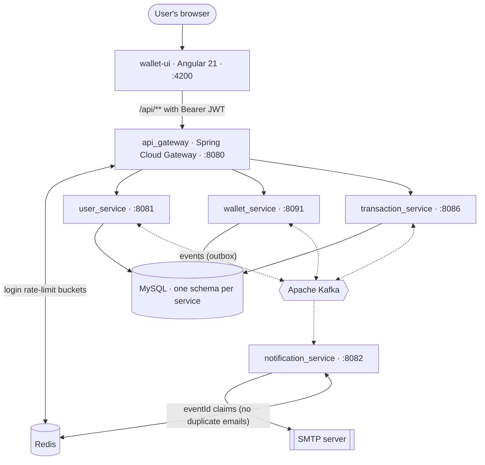

Solid arrows are synchronous HTTP or database calls; dotted arrows are asynchronous Kafka events. Which events flow
where (every arrow is a Kafka topic, published through the [outbox](#reliability-the-transactional-outbox)):

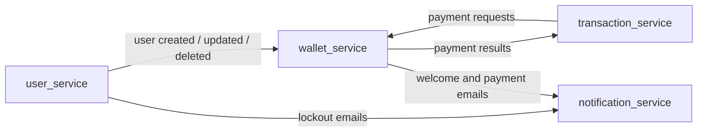

**The big ideas**

- **One public door.** The browser only ever talks to the gateway. It routes requests, checks the JWT, rate-limits logins, adds a correlation ID and returns errors in one consistent format.
- **Services own their data and talk through events.** No service calls another over HTTP. A payment is a *saga*: `transaction_service` records the request, `wallet_service` moves the money atomically, and the result flows back as an event.
- **The wallet is the source of truth for money.** Every balance change happens in one database transaction, with row locks, balance and daily-limit checks, and duplicate protection.
- **Nothing is lost.** Events are written to a database *outbox* together with the data they describe, then relayed to Kafka. Kafka can be down and the system still accepts requests and catches up afterwards.

---

## Services

| Module | Port | Responsibility | Owns (tables) | Publishes | Consumes |
|---|---|---|---|---|---|
| **`api_gateway`** | 8080 | Single entry point: routing, JWT validation, login rate limiting, correlation IDs, uniform errors | (uses Redis) | n/a | n/a |
| **`user_service`** | 8081 | Register and login (issues JWT), profile CRUD, receiver lookup, account lockout | `wallet_user` | user created / updated / deleted, lockout email | n/a |
| **`wallet_service`** | 8091 | Wallets, balances, daily limits; **applies every payment atomically** | `wallet`, `wallet_processed_transaction` | payment result, welcome and payment emails | user events, payment requests |
| **`transaction_service`** | 8086 | Create payments, history, details; tracks status | `wallet_transactions` | payment request | payment result |
| **`notification_service`** | 8082 | Sends emails (logs them if SMTP isn't configured), once per event | none (uses Redis for `eventId` claims) | n/a | emails |
| **`paymesh-common`** | n/a | Shared code: event DTOs, topics, JWT validation, error handling, log correlation, **transactional outbox**, Kafka retries and dead letters | `outbox_event`, `dead_letter` (in each service's schema) | n/a | n/a |
| **`wallet-ui`** | 4200 | Angular app: login and register, dashboard, pay, history, profile | n/a | n/a | n/a |

Each service has **its own schema and MySQL user** on one MySQL server (`user_db`, `wallet_db`, `txn_db`) and can't read the others' tables, so they could move to separate servers without code changes.

---

## How a request travels

Every API call passes through the same gateway pipeline before it reaches a service, and the service checks the token again.

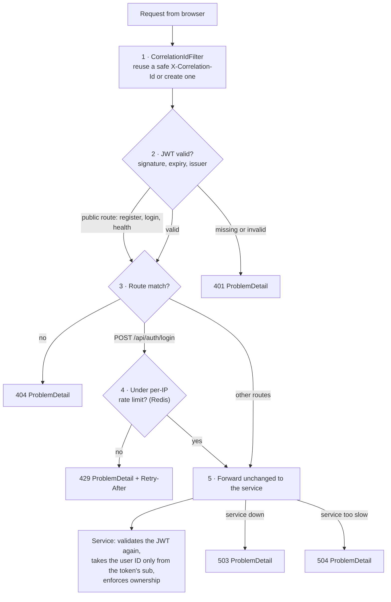

Every response, including errors, carries `X-Correlation-Id`, and every service log line shows it (`INFO [e2e-trace-001] ...`), so one request can be followed through all logs.

---

## Core flows

### 1. Registration: account first, wallet follows

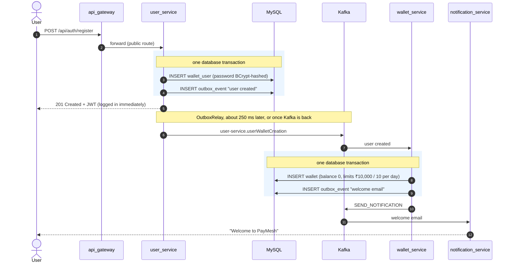

Until the wallet exists, `GET /api/wallets/me` answers *"Wallet not found yet, it is being created"*. The dashboard waits and retries.

### 2. Payments: a saga with the wallet as the source of truth

All four payment types use the same flow. Only which wallet is debited and which is credited changes:

| Type | Debits | Credits | Example |
|---|---|---|---|
| `TRANSFER` | sender | receiver | Pay a friend |
| `ADD_MONEY` | n/a (bank) | you | Top up |
| `WITHDRAW` | you | n/a (bank) | Cash out |
| `BILL_PAYMENT` | you | n/a (biller) | Mobile recharge, electricity, … |

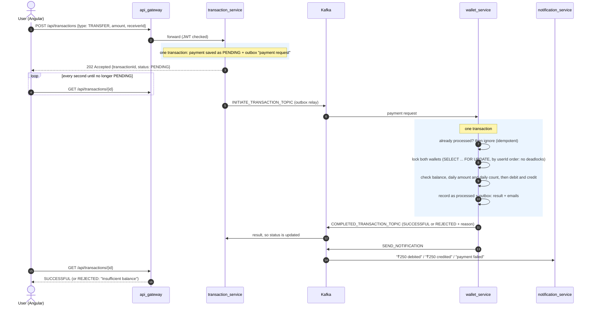

**Payment status lifecycle**

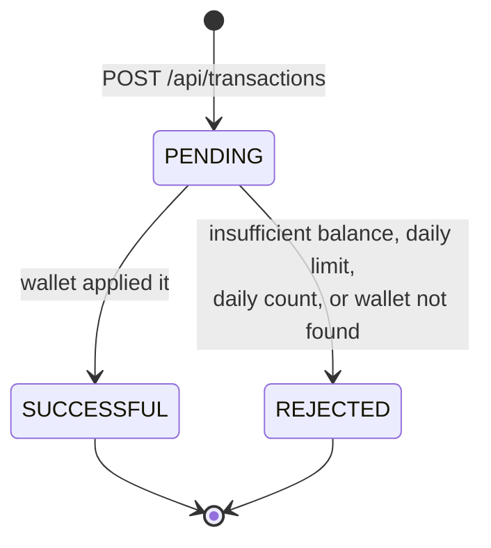

Why the money stays correct:

- **No double spending.** Balance is checked and changed under a row lock, in the same transaction. In a test, 8 parallel ₹300 sends from a ₹1,200.50 balance gave exactly 4 successes and left ₹0.50.
- **No double applying.** Each `transactionId` is recorded in `wallet_processed_transaction` in the same transaction, so a redelivered message is ignored.
- **No lost payments.** The request and the result both go through the outbox.
- **Exact amounts.** Money is `BigDecimal` / `DECIMAL(19,2)` end to end.

### 3. Login: two independent brute-force defences

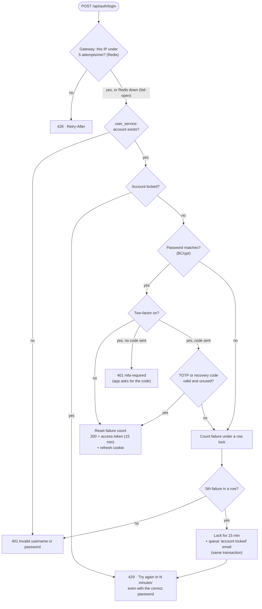

The lockout email carries a **one-time unlock link** (valid until the lock would end anyway, at most 30 minutes; single use; replaced by any newer lock). It opens the web app's `/unlock` page, and only the owner's click on **Unlock my account** sends the token: opening the link, or a scanner loading the page, changes nothing.

| Defence | Where | Stops | Default |
|---|---|---|---|
| **Per-IP rate limit** | gateway + Redis | one machine hammering many accounts | 5 attempts, then 1 every 12 s |
| **Per-account lockout** | user_service + MySQL | many machines hammering one account | 5 wrong passwords **or codes**, then 15 min lock |
| **Two-factor login** (optional) | user_service | a leaked password on its own | TOTP (RFC 6238, any authenticator app) + 8 single-use recovery codes |

---

## Reliability: the transactional outbox

Writing to the database and then publishing to Kafka are **two separate systems**. If the process crashes between them, or Kafka is down, an event is lost: a user with no wallet, or a payment stuck at PENDING forever. The outbox makes the event part of the database transaction.

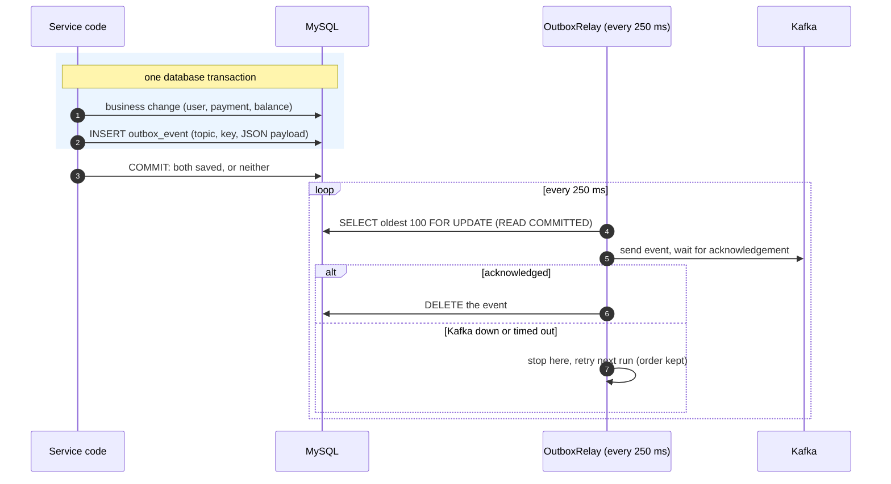

| Situation | What happens |
|---|---|
| Kafka is down | Requests still succeed **instantly**; events wait in `outbox_event`; the relay retries; everything completes once Kafka is back (verified live) |
| Service crashes after commit | Events are already in the table; the relay sends them after restart |
| Crash after Kafka ack, before delete | The event is sent **again**: delivery is *at-least-once*, so consumers are idempotent (below) |
| Two instances of one service | Rows are locked while being sent: no concurrent double publishing, order kept |
| Kafka slow to respond | Writers are **not** blocked: the relay reads at `READ COMMITTED`, so MySQL takes no gap locks |

**Every consumer tolerates duplicates:**

| Consumer | Why a duplicate is harmless |
|---|---|
| Create wallet | Skips if the wallet already exists (no second welcome email) |
| Update or delete wallet owner | Setting the same values again changes nothing |
| Apply payment | `wallet_processed_transaction` records each `transactionId` |
| Update payment status | Only a `PENDING` payment takes a result; a late or repeated result for a final payment is ignored |
| Send email | The event's `eventId` is claimed in Redis (`notification:sent:<eventId>`, 7 days) before sending; a claimed id is skipped |

`Outbox.publish(...)` runs only inside an existing transaction (`Propagation.MANDATORY`). Calling it anywhere else is a programming error and fails immediately.

**Every event carries two headers**, set by the relay from the outbox row:

| Header | Purpose |
|---|---|
| `eventId` | Unique per event (UUID); consumers without a natural business key dedupe on it |
| `correlationId` | The request's `X-Correlation-Id`; consumers put it back into the log context, and the events they write carry it on, so one payment can be followed through every service's logs |

### When a message can't be handled

1. **Retry:** every listener gets 3 attempts, 0.5 s then 1 s apart (one `DefaultErrorHandler` in `paymesh-common`). Unparseable JSON can never succeed, so it skips the retries.
2. **Park:** the message goes to `<topic>.DLT` with the exception in its headers, and the partition moves on: one bad message never blocks the ones behind it.
3. **Keep:** wallet_service and transaction_service consume their own DLTs into a `dead_letter` table (topic, key, payload, exception, status `NEW` / `REPLAYED` / `DISCARDED`). If storing fails (database down), the DLT consumer retries every 2 s until it works rather than dead-lettering a dead letter; only DLT partitions wait.
4. **Replay or discard:** `DeadLetterStore.replay(id)` puts the payload back on its original topic **through the outbox**, in the same transaction as the status change, so a replay is never lost or doubled. (Admin endpoints for this arrive with the admin console.)

notification_service has no database, so its failures stay on `SEND_NOTIFICATION.DLT`; replay them with the Kafka CLI.

---

## Double-entry ledger

A balance column says *what* a wallet holds, never *why*. Every successful payment therefore also writes a **journal entry** in wallet_service: one debit and one credit of the same amount, in the same database transaction as the row-locked balance change. `wallet.balance` stays as a cached balance (O(1) reads), and the ledger can prove it.

| Payment | Debit | Credit |
|---|---|---|
| Transfer | sender | receiver |
| Add money | `PG_CLEARING` (money arriving from the payment gateway) | user |
| Withdraw | user | `BANK_PAYOUT_CLEARING` (owed to the user's bank) |
| Bill payment | user | `BILLER_PAYABLE` (owed to the biller) |
| Balance from before the ledger | `OPENING_BALANCE` | user |

- **Accounts:** one per user (`USER:<id>`, opened with the wallet) plus the system accounts above. User accounts are credit-normal: **balance = credits − debits**.
- **Rules as a pure function:** `LedgerEntries.forPayment(...)` turns a payment into lines with no Spring and no database, so jqwik checks its invariants over thousands of generated payments (always balanced, users move the right way, the right counterparty).
- **Exactly once:** rejected payments post nothing; `journal_entry.transaction_id` is unique, behind the existing `wallet_processed_transaction` check.
- **Opening balances:** the migration that introduced the ledger posted every existing balance against `OPENING_BALANCE`, so history starts consistent. Roll it out with **every wallet_service replica stopped first** (Kubernetes `Recreate`): an old replica still running after the migration would change balances without postings, and reconciliation would flag those wallets from then on.
- **Reconciliation:** `ReconciliationService` runs nightly (`LEDGER_RECONCILE_CRON`, default 02:30) on **one replica only** (ShedLock row lock, using the database clock). It checks every wallet's cached balance against its postings and that all postings net to zero; a failure is logged at ERROR naming each user and the difference, e.g. `user 3: wallet 101.00, ledger 100.00 (off by 1.00)`.

---

## Observability

Every service sends **traces, logs and metrics** over OpenTelemetry (OTLP) to one collector, the `lgtm` container (in Compose and in the Helm chart): Grafana with Tempo (traces), Loki (logs) and Prometheus (metrics). Open **http://localhost:3000** (admin / admin; on k3d, port-forward first).

**One payment, one trace.** A transfer shows up in Tempo as a single trace across every hop, including the two Kafka round trips:

```
api-gateway  http post
└─ transaction-service  POST /api/transactions
   └─ outbox relay INITIATE_TRANSACTION_TOPIC → send
      └─ wallet-service  INITIATE_TRANSACTION_TOPIC process
         ├─ outbox relay COMPLETED_TRANSACTION_TOPIC → send
         │  └─ transaction-service  COMPLETED_TRANSACTION_TOPIC process
         └─ outbox relay SEND_NOTIFICATION → send
            └─ notification-service  SEND_NOTIFICATION process
```

The outbox is what normally breaks a trace: the event is written in the request's transaction but sent later, by another thread. Each outbox row therefore stores the W3C `traceparent` of the request that wrote it, and the relay sends inside a span restored from it (`OutboxTracing`), so the Kafka send, the consumer and everything after join the original trace. Every log line carries the `trace_id` it belongs to, so Loki and Tempo link both ways.

| Metric | What it shows |
|---|---|
| `paymesh_payments_completed_total{status,type}` | Payments reaching a final status |
| `paymesh_payments_duration_milliseconds` (histogram) | Time from creating a payment to its result (the whole saga); the dashboard shows p50/p95/p99 |
| `paymesh_outbox_backlog` | Events written but not yet on Kafka, per service |
| `paymesh_deadletters_new` | Messages that failed all retries and wait for replay |
| `paymesh_ledger_mismatches` | Problems found by the last nightly reconciliation |

Plus HTTP, JVM, and Kafka client metrics (consumer lag included). Tags stay low-cardinality: never user ids, transaction ids or amounts.

**Provisioned as code** (`deploy/helm/paymesh/files/observability`): two dashboards (*Payments*; *Messaging & ledger*) and three alert rules: outbox backlog above 100 for 5 minutes, any dead letter waiting, any ledger mismatch.

**Emails and mobile numbers are masked before storage.** The collector's `transform/scrub` step masks email addresses and Indian mobile numbers (with or without `+91`/`0`) in every log line, log and span attribute, span name and span event (exception messages) before anything is written, and notification_service logs a mail it isn't sending with a masked recipient and no body (the full text only at DEBUG). Scheduled pollers and health probes aren't traced, so they don't bury real requests.

Export is off by default (`OTLP_ENABLED=false`), so tests and plain IDE runs don't look for a collector; Compose and the Helm chart turn it on. Export is batched and asynchronous: with the collector down, requests are unaffected.

---

## Kubernetes deployment

The Helm chart in `deploy/helm/paymesh` is the one that runs in production (k3s on AWS), and it runs locally on k3d ([Path B](#path-b-kubernetes-on-k3d-the-production-setup)).

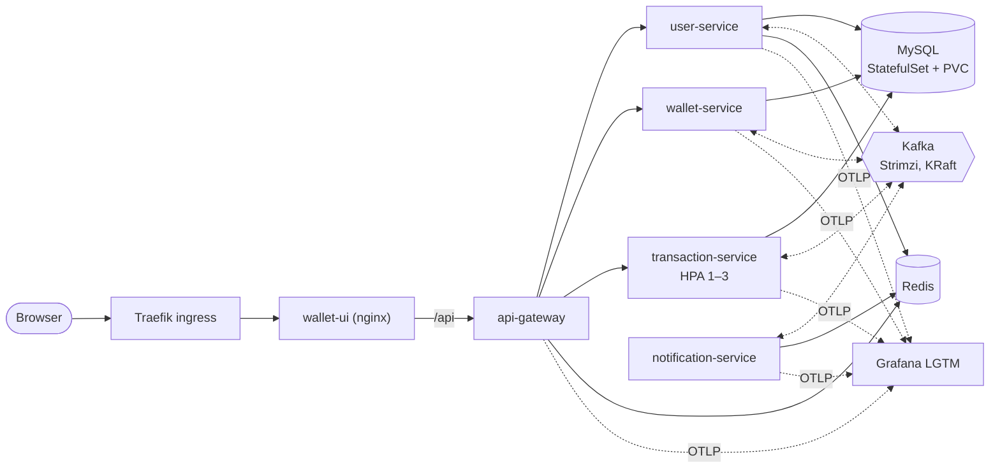

| In the cluster (namespace `paymesh`) | How |
|---|---|
| 5 Spring services | one shared Deployment template with a values entry each; actuator liveness, readiness and startup probes; non-root, read-only root filesystem; 512 Mi each (`-XX:+UseSerialGC -XX:MaxRAMPercentage=60`) |
| wallet-ui | nginx with `/api` proxied to the gateway, behind Traefik (k3s's ingress) |
| Kafka | Strimzi operator, one KRaft node (controller + broker); topics auto-created |
| MySQL | StatefulSet with a persistent volume; the same init script as compose |
| Redis, Grafana LGTM | Deployments (their data is disposable) |
| Secrets | `paymesh-secrets`, created from `.env` by the script; the chart only references it |

- **NetworkPolicies:** everything is denied unless allowed:
  - Traefik can reach wallet-ui, wallet-ui can reach the gateway, and the gateway can reach the services.
  - The services can reach user-service (for its signing keys), their own data stores and Grafana.
  - Any other pod is refused, even inside the namespace.
- **Autoscaling:** transaction-service scales from 1 to 3 pods at 70% CPU. Scale-up waits 3 minutes, so JVM warm-up alone doesn't add pods.
- **Rollouts:** wallet-service uses `Recreate`, so two versions never run against the ledger at once.
- **Memory:** about 3.2 GB in total for the whole stack.
- **Client IP:** the gateway trusts two proxies (Traefik, then nginx) for `X-Forwarded-For`. In production, Traefik's Service needs `externalTrafficPolicy: Local`; otherwise every client looks like the node and shares one login rate-limit bucket.

---

## Data model

Each service owns its schema on one MySQL server (`user_db`, `wallet_db`, `txn_db`), with its own MySQL user and its own Flyway migrations. **No foreign keys or queries cross service boundaries**: a service user can't even read another schema. The dotted lines are logical references by ID.

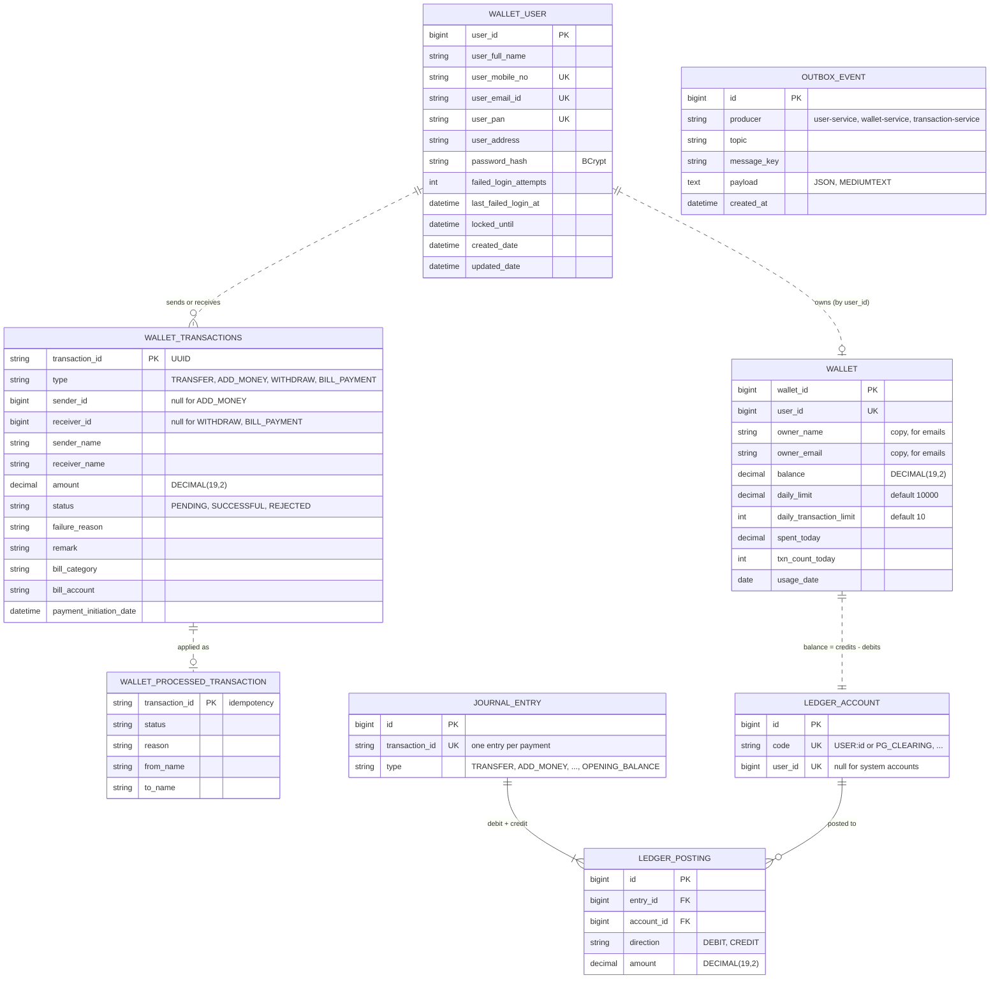

Schemas and users are created once, with the MySQL volume, by `deploy/helm/paymesh/files/mysql-init/01-service-schemas.sh`. Each service's tables come from Flyway migrations in `src/main/resources/db/migration`, and Hibernate only checks them (`ddl-auto=validate`), so a mismatch stops the service at startup instead of silently altering tables.

**Schema changes:** add `V<n>__<what_changed>.sql` next to the service's existing migrations. Never edit a migration that has already run; Flyway checksums it. Enum columns are MySQL `enum(...)`, so a new enum constant needs an `ALTER TABLE ... MODIFY` migration. Once a service runs more than one replica, make changes **expand then contract**: a migration must keep working for the previous version still running during a rollout (add a column as nullable or with a default, backfill, and tighten it in a later release).

---

## Kafka event catalogue

| Topic | Producer | Consumer(s) | Key | Payload |
|---|---|---|---|---|
| `user-service.userWalletCreation` | user_service | wallet_service | userId | `{userId, userName, userEmailId}` |
| `user-service.userUpdation` | user_service | wallet_service | userId | `{userId, userName, userEmailId}` |
| `user-service.userDeletion` | user_service | wallet_service | userId | `userId` (deletes the wallet only if its balance is 0) |
| `INITIATE_TRANSACTION_TOPIC` | transaction_service | wallet_service | transactionId | `{transactionId, fromUserId, toUserId, amount, type}` (`type` picks the ledger accounts) |
| `COMPLETED_TRANSACTION_TOPIC` | wallet_service | transaction_service | transactionId | `{transactionId, paymentStatus, reason, fromName, toName}` |
| `SEND_NOTIFICATION` | user_service, wallet_service | notification_service | recipient email | `{receiverMailId, subject, message}` |

Keys keep ordering per user and per transaction. Payload classes live in `paymesh-common/.../dto`. Every topic has a `<topic>.DLT` twin for messages that failed all retries, and every message carries `eventId` and `correlationId` headers (see [Reliability](#reliability-the-transactional-outbox)).

---

## Security model

**Two layers, no shortcuts.** The gateway rejects bad tokens early. Each service validates the **same token again** and takes the user's identity only from its `sub` claim, never from a request field. A `senderId` or `userId` sent in a request body is ignored. The gateway adds no identity headers, and no service trusts any.

| Area | Implementation |
|---|---|
| **Tokens** | **RS256** access tokens signed by user_service, **15 min**: `sub` = userId, `name`, `roles`, `amr`, `jti`, `iss` = `paymesh`. The gateway and every service verify signature, expiry and issuer against user_service's public keys at `/.well-known/jwks.json` (fetched once, cached, refetched when a token names an unknown key). |
| **Keys** | Only user_service holds a private key (`JWT_PRIVATE_KEY`, PKCS#8 PEM; generated per start if unset). The gateway and services hold public keys only: none of them can mint a token. HS256 tokens are rejected. |
| **Sessions** | Login sets a **refresh token** in an `HttpOnly; Secure; SameSite=Strict` cookie scoped to `/api/auth` (7 days; only its SHA-256 is stored). `POST /api/auth/refresh` rotates it and returns a new access token. **Reusing** an already-rotated refresh token (theft, or a stale tab) revokes the whole session family. The web app keeps the access token **in memory only**. |
| **Logout** | `POST /api/auth/logout` revokes the refresh family and puts the access token's `jti` on a Redis denylist (TTL = its remaining lifetime) that the gateway checks on every request: the token stops working **immediately**. |
| **Roles** | `USER` or `ADMIN` (`roles` claim → `ROLE_*`). `/api/admin/**` requires ADMIN at the gateway and in every service. ADMIN is granted by **user id** (`ADMIN_USER_IDS`) or the `role` column, never by email (emails are unverified and editable). |
| **Two-factor** | Optional TOTP (RFC 6238, implemented in-house and checked against the RFC's test vectors): secret on the account, a code works once (`totp_last_step`), 8 recovery codes stored as hashes (80 bits each). Setting it up or turning it off needs the **password**; wrong codes and passwords count toward the account lockout, checked under the user's row lock so parallel guesses can't slip past. Turning it on or off signs out every session and emails the owner. |
| **Step-up** | Payments over ₹5,000 (`STEP_UP_THRESHOLD`) by users with two-factor need a token with `amr` containing `otp`, issued in the last 5 minutes; otherwise `403 step-up-required` and the app asks for the code (`POST /api/users/me/step-up`). 403, not 401, because the app treats 401 as "refresh the session". |
| **Public endpoints** | Only `POST /api/auth/register`, `/login`, `/refresh`, `/logout` and `GET /actuator/health` (status only). Everything else needs a token; unknown paths are denied. |
| **Ownership** | Each user sees and changes only their own profile, wallet and transactions; other people's transactions return **404**. |
| **Brute force** | Per-IP rate limit at the gateway (Redis) and per-account lockout in user_service ([details](#3-login-two-independent-brute-force-defences)) |
| **Passwords** | BCrypt; never logged or returned |
| **Errors** | `application/problem+json` everywhere; a 401 never says *why* a token failed; no stack traces reach clients |
| **Logs** | No tokens, passwords, emails or message payloads. Failed Kafka sends log the topic and error only. |
| **Spoofing** | `X-Forwarded-For` is ignored unless `TRUSTED_PROXY_COUNT` says your own proxy added it; correlation IDs from clients are reused only if they match `[A-Za-z0-9-]{1,64}` |

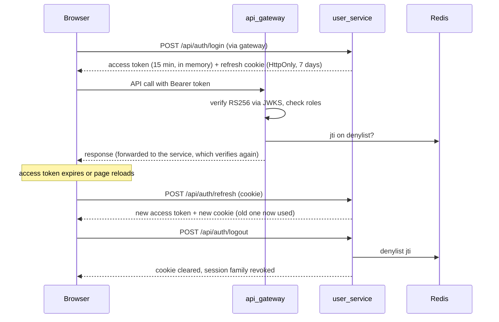

### Production network boundary


Only the gateway (and the static UI) may be reachable from the internet. Use no published ports in Docker, `ClusterIP` in Kubernetes, or security groups that admit only the gateway. Set `TRUSTED_PROXY_COUNT` to the number of proxies in front of the gateway: 1 behind nginx alone (compose), 2 behind Traefik plus nginx (the Helm chart sets this), otherwise all users share the load balancer's rate-limit bucket. Locally, services also listen on `localhost` ports for debugging. The Helm chart enforces this boundary with NetworkPolicies.

---

# Part 3: Reference

---

## API reference

Base URL: the gateway, `http://localhost:8080` (IDE runs and k3d); with Docker Compose use `http://localhost:4200`, which proxies `/api` to it. All bodies are JSON. 🔒 = needs `Authorization: Bearer <token>`.

### Auth and users (user_service)

| Method | Path | Auth | Description |
|---|---|---|---|
| POST | `/api/auth/register` | public | Create account; returns `{token, user}` and sets the refresh cookie |
| POST | `/api/auth/login` | public | `{username: mobile or email, password, otp?}`; returns `{token, user}` and sets the refresh cookie; `401 mfa-required` when two-factor is on and no code was sent |
| POST | `/api/auth/refresh` | cookie | New `{token, user}` and a new cookie; `401` (cookie cleared) if expired, revoked or reused |
| POST | `/api/auth/logout` | cookie | Ends the session (refresh family revoked, access token denylisted); always `204` |
| POST | `/api/auth/unlock` | public | `{token}` from the lockout email's link; `204`, or `400` if invalid, used or expired |
| POST | `/api/users/me/2fa/setup` | 🔒 | `{password}` → `{secret, otpauthUri}` for an authenticator app |
| POST | `/api/users/me/2fa/enable` | 🔒 | `{code}` → `{recoveryCodes}` (shown once); signs out every session |
| POST | `/api/users/me/2fa/disable` | 🔒 | `{password, code}`; signs out every session |
| POST | `/api/users/me/step-up` | 🔒 | `{code}` → fresh `{token, user}` for large payments |
| GET | `/api/users/me` | 🔒 | My profile |
| PUT | `/api/users/me` | 🔒 | Update `{fullName, emailId, address}` |
| DELETE | `/api/users/me` | 🔒 | Delete account (withdraw your balance first) |
| GET | `/api/users/lookup?mobile=98…` | 🔒 | Find a receiver: `{userId, fullName}` |

### Wallet (wallet_service)

| Method | Path | Auth | Description |
|---|---|---|---|
| GET | `/api/wallets/me` | 🔒 | `{walletId, balance, dailyLimit, dailyTransactionLimit, spentToday, transactionsToday}` |
| PUT | `/api/wallets/me/limits` | 🔒 | `{dailyLimit: 100–100000, dailyTransactionLimit: 1–50}` |

### Transactions (transaction_service)

| Method | Path | Auth | Description |
|---|---|---|---|
| POST | `/api/transactions` | 🔒 | Start a payment; returns `202` with `status: PENDING` |
| GET | `/api/transactions?page=0&size=20` | 🔒 | My history, newest first |
| GET | `/api/transactions/{id}` | 🔒 | Details (404 if I'm not sender or receiver) |

**Idempotency-Key (optional, the web app always sends one):** send any unique string (≤ 255 chars, e.g. a UUID) with `POST /api/transactions`, and a retry of the same request — double click, timeout, flaky network — returns the **original** response with `Idempotent-Replayed: true` instead of creating a second payment. Reusing a key with a different body is `422`. Keys are per user and remembered for 24 h. Only successful creations are remembered, so a request rejected by validation can be fixed and retried with the same key.

**Validation rules:** mobile `[6-9]` + 9 digits · password 8–64 chars · PAN `ABCDE1234F` (optional) · amount ₹1–₹1,00,000 with at most 2 decimals · remark up to 100 chars.

### Examples

```bash
# Register (you're logged in straight away)
curl -s -X POST localhost:8080/api/auth/register -H 'Content-Type: application/json' \
  -d '{"fullName":"Asha Verma","mobileNo":"9876543210","emailId":"asha@example.com","password":"secret123"}'

# Log in, keep the token
TOKEN=$(curl -s -X POST localhost:8080/api/auth/login -H 'Content-Type: application/json' \
  -d '{"username":"9876543210","password":"secret123"}' | jq -r .token)

# Add money
curl -s -X POST localhost:8080/api/transactions -H "Authorization: Bearer $TOKEN" -H 'Content-Type: application/json' \
  -d '{"type":"ADD_MONEY","amount":1000}'

# Safe to retry: the same Idempotency-Key never pays twice
curl -s -X POST localhost:8080/api/transactions -H "Authorization: Bearer $TOKEN" -H 'Content-Type: application/json' \
  -H 'Idempotency-Key: 6f1c2a9e-topup-1' -d '{"type":"ADD_MONEY","amount":1000}'

# Send money (find the receiver's userId with /api/users/lookup first)
curl -s -X POST localhost:8080/api/transactions -H "Authorization: Bearer $TOKEN" -H 'Content-Type: application/json' \
  -d '{"type":"TRANSFER","amount":250.50,"receiverId":2,"remark":"Dinner"}'

# Mobile recharge
curl -s -X POST localhost:8080/api/transactions -H "Authorization: Bearer $TOKEN" -H 'Content-Type: application/json' \
  -d '{"type":"BILL_PAYMENT","amount":299,"billCategory":"MOBILE_RECHARGE","billAccount":"9876543210"}'
```

`billCategory` is one of `MOBILE_RECHARGE`, `DTH`, `ELECTRICITY`, `WATER`, `GAS`, `BROADBAND`.

### Error format

Every error from the gateway and from services looks like this:

```json
{
  "type": "about:blank",
  "title": "Bad Request",
  "status": 400,
  "detail": "mobileNo must be a valid 10 digit mobile number, password size must be between 8 and 64",
  "instance": "/api/auth/register"
}
```

| Status | Meaning |
|---|---|
| 400 | Validation failed (`detail` names the fields) |
| 401 | Missing, invalid or expired token, or wrong credentials |
| 404 | Not found, or not yours |
| 409 | Mobile, email or PAN already registered |
| 429 | Too many login attempts (IP) or account locked; see `Retry-After` |
| 503 / 504 | A service is down / too slow (from the gateway) |

---

## Configuration

All settings come from environment variables with local-friendly defaults.

| Variable | Default | Used by | Purpose |
|---|---|---|---|
| `JWT_PRIVATE_KEY` | empty (a new key per start) | user | RSA private key (PKCS#8 PEM) that signs access tokens |
| `JWT_JWKS_URI` | `http://localhost:8081/.well-known/jwks.json` | gateway, wallet, transaction, notification | Where to fetch the public signing keys |
| `ADMIN_USER_IDS` | empty | user | Comma-separated user ids that get the ADMIN role |
| `AUTH_COOKIE_SECURE` | `true` | user | `Secure` flag on the refresh cookie (browsers treat localhost as secure; turn off only for plain-HTTP non-localhost setups) |
| `APP_PUBLIC_URL` | `http://localhost:4200` | user | Base URL for links in emails (account unlock) |
| `STEP_UP_THRESHOLD` | `5000` | transaction | Payments above this need a fresh two-factor code (users with two-factor on) |
| `JWT_ISSUER` | `paymesh` | all | Expected `iss` claim |
| `DB_URL` | `jdbc:mysql://localhost:3306/user_db` (`wallet_db`, `txn_db`) | user, wallet, transaction | The service's own schema |
| `DB_USERNAME` / `DB_PASSWORD` | **required** (`local` profile: `user_svc` / `wallet_svc` / `txn_svc`, password `change-me-local-only`) | user, wallet, transaction | The service's own MySQL user |
| `USER_DB_PASSWORD` / `WALLET_DB_PASSWORD` / `TXN_DB_PASSWORD` | **required** (compose only) | mysql init, services | Passwords for the three service users |
| `KAFKA_SERVERS` | `localhost:9092` | all services | Kafka bootstrap servers |
| `IDEMPOTENCY_RETENTION` | `PT24H` | transaction | How long `Idempotency-Key` responses are remembered |
| `OTLP_ENABLED` | `false` (compose: `true`) | all | Send traces, logs and metrics over OTLP |
| `OTLP_ENDPOINT` | `http://localhost:4318` | all | The OpenTelemetry collector (compose: `http://lgtm:4318`) |
| `TRACING_SAMPLING` | `1.0` | all | Share of requests traced (lower it under real load) |
| `LEDGER_RECONCILE_CRON` | `0 30 2 * * *` (02:30 daily) | wallet | When the ledger reconciliation runs (Spring cron, one replica via ShedLock) |
| `USER_SERVICE_URL` / `WALLET_SERVICE_URL` / `TRANSACTION_SERVICE_URL` | `http://localhost:8081` / `:8091` / `:8086` | gateway | Route targets |
| `REDIS_HOST` / `REDIS_PORT` / `REDIS_PASSWORD` | `localhost` / `6379` / none | gateway | Rate-limit store |
| `LOGIN_RATE_LIMIT_BURST_CAPACITY` / `…_REQUESTED_TOKENS` / `…_REPLENISH_RATE` | `60` / `12` / `1` | gateway | Token bucket: 5 attempts at once, then 1 every 12 s |
| `TRUSTED_PROXY_COUNT` | `0` (compose: `1`, Helm: `2`) | gateway | Proxies in front of the gateway that append to `X-Forwarded-For` |
| `LOGIN_LOCKOUT_MAX_FAILED_ATTEMPTS` / `LOGIN_LOCKOUT_DURATION` | `5` / `15m` | user | Account lockout policy |
| `MAIL_HOST` / `MAIL_PORT` | `smtp.gmail.com` / `587` | notification | SMTP server |
| `MAIL_USERNAME` / `MAIL_PASSWORD` | unset, so emails are only logged | notification | SMTP login (Gmail: use an App Password) |

Advanced (Spring properties): `outbox.poll-interval-ms` (default `250`), `spring.kafka.producer.properties.max.block.ms` (default `5000`).

---

## Testing

The suite runs against **real** infrastructure wherever correctness depends on it: MySQL for locking, isolation and column sizes, and Redis for rate limiting. Several bugs that mocked tests missed were caught this way.

| Module | What's covered |
|---|---|
| `api_gateway` | Routing with unchanged paths; public allowlist; rejected tokens (missing, malformed, expired, wrong signature, wrong issuer); 404/503/504 ProblemDetails; correlation IDs (generated, reused, malicious values replaced); startup secret check; login rate limit (429 + `Retry-After`, only login limited, spoofed `X-Forwarded-For` ignored, works when Redis hangs) |
| `paymesh-common` | Shared JWT validation; secret checks; log correlation filter; Kafka producer defaults; payload-free failure logging; **outbox**: refuses calls outside a transaction, all-or-nothing with the data, in-order relay, stops at the first failure, ignores other services' rows, large payloads, never blocks writers |
| `user_service` | Token issuance (`iss`, `sub`); ownership; registration queues wallet creation; lockout rules, 429 + `Retry-After`, correct password refused while locked, exactly one email per lock; real MySQL: 12 parallel guesses give one lock and one email; Kafka outage keeps the registration event |
| `wallet_service` | Debit and limit rules; payment results and emails queued with the change; duplicates ignored; ownership |
| `transaction_service` | Sender taken from the token, never the body; payment queued with its event; not-yours gives 404; history scoped to the caller; idempotency keys (replay, conflicting body, concurrent duplicates); metrics |
| `wallet_service` (ledger) | jqwik properties over generated payments (always balanced, right accounts); journal written once per payment; reconciliation finds tampered balances; one trace through the outbox |
| `wallet-ui` | Vitest: API client and token refresh, unlock page, profile (two-factor) |

---

## Project structure

```
paymesh/
├── api_gateway/                 Spring Cloud Gateway (reactive)
│   └── src/main/java/com/paymesh/gateway/
│       ├── security/            JWT validation, 401 ProblemDetail entry point
│       ├── ratelimit/           client-IP key resolver, 429 ProblemDetail filter
│       ├── correlation/         X-Correlation-Id filter
│       └── error/               503/504/404 ProblemDetail handler
├── paymesh-common/       shared jar (component-scanned by every service)
│   └── src/main/java/com/paymesh/
│       ├── dto/  constants/  enums/   event payloads and topic names
│       ├── security/            SecurityConfig (JWT), JwtProperties, ApiExceptionHandler
│       ├── outbox/              Outbox, OutboxRelay, OutboxEvent (transactional outbox)
│       ├── kafka/               producer defaults (5 s max block, payload-free logging)
│       └── logging/             correlation ID → log context
├── user_service/                accounts, JWT issuing, lockout (Flyway: src/main/resources/db/migration)
├── wallet_service/              wallets, balances, applying payments (Flyway as above)
├── transaction_service/         payments, history (Flyway as above)
├── notification_service/        emails
├── wallet-ui/                   Angular 21 app
│   └── src/app/
│       ├── api.ts               HTTP client, JWT interceptor, auth guard, types
│       └── pages/               auth · dashboard · pay · history · profile · txn-list
├── deploy/helm/paymesh/         Helm chart (Kubernetes)
│   ├── templates/               services, wallet-ui + ingress, mysql, redis, kafka (Strimzi), lgtm, NetworkPolicies
│   └── files/                   MySQL init script; collector config, dashboards, alerts (also mounted by compose)
├── scripts/k3d-up.sh            runs the whole stack on a local k3d cluster
├── scripts/build-images.sh      builds compose images one at a time (non-ASCII path workaround)
├── .env.example                 secrets template for compose (copy to .env)
├── Dockerfile                   one image per Spring Boot service (--build-arg SERVICE=<module>)
├── docker-compose.yml           whole stack, or infra only for IDE runs
└── Requirements                 original project brief
```

---

## Design decisions

| Decision | Why |
|---|---|
| **Saga over Kafka instead of synchronous HTTP between services** | Services stay independent; a slow or down service doesn't cascade; payments resume after outages |
| **Wallet service decides, not transaction service** | The balance check and the debit happen in *one* transaction under row locks. Checking in one service and debiting in another allowed double spending in the original design. |
| **Transactional outbox** | DB-then-Kafka loses events on crashes and outages; the outbox makes events part of the commit |
| **JWT validated at gateway *and* services** | Defence in depth: bypassing the gateway grants nothing; services never trust headers |
| **RS256 + JWKS instead of a shared secret** | Only user_service can mint tokens; a compromised gateway or service can't forge identities; a new key gets a new `kid`, and verifiers refetch the JWKS when they see one (only one key is published at a time, so tokens signed by the old key stop verifying and are silently refreshed) |
| **Short access token + rotating refresh cookie** | A stolen access token is useful for 15 minutes; the refresh token is out of JavaScript's reach (HttpOnly) and a copied one is detected on reuse |
| **Schema per service, Flyway migrations, `ddl-auto=validate`** | Services can't couple through tables; every schema change is reviewed SQL with a history; a drifted schema fails fast at startup |
| **Double-entry ledger plus a cached balance** | Reads stay O(1); every rupee is explained by balanced postings, and a nightly reconciliation proves cache and ledger agree |
| **Ledger rules as a pure function** | The invariants (balanced, right accounts) are property-tested over thousands of generated payments, independent of Spring and MySQL |
| **Idempotency key stored in the payment's own transaction** | Key, payment and outbox event commit together; concurrent duplicates serialise on the unique `(user, key)` index and replay the winner's response, with no lock service |
| **Trace context stored on outbox rows** | Without it every payment would break into separate traces at the outbox; with it, one trace covers request, Kafka hops and consumers |
| **Scrubbing in the collector, not in each service** | One place masks personal data for every service and signal, including libraries' own log lines |
| **`BigDecimal` for money** | `double` can't represent ₹0.10 exactly |
| **ProblemDetail (RFC 7807) everywhere** | One error shape for the UI, from the gateway and every service |
| **`spring.jpa.open-in-view=false` in user_service** | With it on, the row-locked read returned a stale cached copy and concurrent failed logins overwrote each other's count |
| **Gateway on its own Boot parent** | The root POM adds servlet `spring-boot-starter-webmvc` to every module; the gateway must be reactive |
| **Java 21 virtual threads** (`spring.threads.virtual.enabled`) | Every service blocks on JDBC, Kafka or SMTP; virtual threads make that cheap without going reactive |
| **Fail-open rate limiting** | A Redis outage must not lock every user out; the per-account lockout still applies |

---

## Known limitations and roadmap

- **Emails are at-most-once.** Duplicates are suppressed by `eventId`; a crash between claiming the id and sending can lose one email (by design: a duplicate payment email is worse than a missing one). If Redis is down, mail is sent without the duplicate check.
- **Notification dead letters** stay on `SEND_NOTIFICATION.DLT` (notification_service has no database); replay them with the Kafka CLI.
- **Lockout can be abused**: someone who knows a mobile number can keep locking that account. The owner can unlock it straight away from the email link; a CAPTCHA after failures would stop the nuisance itself.
- **Users behind one shared IP** (office, mobile carrier NAT) share a login rate-limit bucket.
- **Simulated bank**: add money and withdraw don't call a real payment gateway (Razorpay top-ups are on the roadmap).
- **Roadmap:** AWS deployment with GitOps (Argo CD), a redesigned UI with a demo mode, live updates, payment requests and split bills, a risk engine, an admin console, rewards, and analytics.
